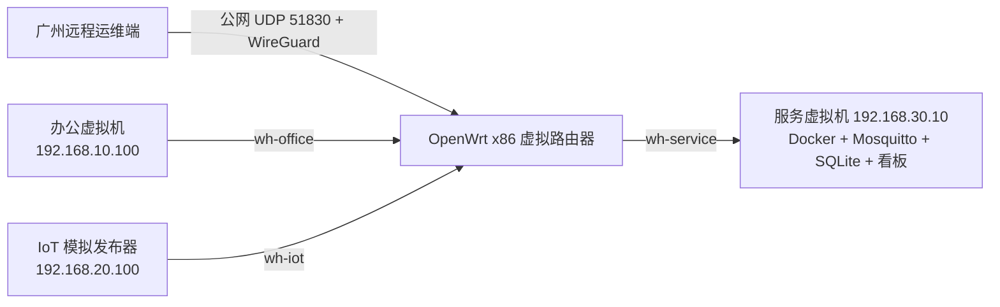

# 小型仓库网络分区与远程运维

## 毕业设计题目

《基于 OpenWrt 的小型仓库网络分区与远程运维系统设计与实现》

## 企业场景

一家小企业的仓库没有驻场网管。仓管白天在现场办公，温湿度终端持续采集机柜附近环境，总部网管通过远程隧道检查现场服务。办公设备、IoT 设备和服务主机共用路由器，按所需通信划分权限。外网中断时，现场采集和查看持续运行。

毕业设计主要展示网络规划、分区与远程接入、按证据定位故障，以及恢复后的复测。环境采集提供可观察的实际业务。

## 当前实现：单电脑虚拟仓库

当前使用四台 VMware 虚拟机复现办公、IoT、服务区及路由器，广州服务器作为独立远程运维端。温湿度来自 IoT 虚拟机中的明确标注模拟发布器。详细运行与实测范围见 [虚拟实验说明](docs/virtual-lab.md) 和 [项目进度](PROGRESS.md)。



| 分区 | 地址 | 对服务主机的权限 |
| --- | --- | --- |
| 办公网 | 192.168.10.0/24 | TCP 8080 看板 |
| IoT 网 | 192.168.20.0/24 | TCP 1883 MQTT |
| 服务区 | 192.168.30.0/24，主机 .10 | 有线接入，承担可信维护 |
| VMware WAN | 192.168.200.0/24，路由器 .50，既有 NAT 网关 .1 | 未建隧道不得直达服务 |
| 广州独立 WireGuard | 10.89.0.1/32，路由器 10.89.0.2/32 | 服务主机 TCP 8080、22 |

MQTT 设备账号仅能发布自己的主题，看板账号仅读取该主题。SSH 由服务主机提供。广州仅下发服务主机与路由器 peer 的 /32 路由，不承担现场上网转发。美国服务器及其 v2rayN 转发不参与本阶段部署。

硬件到位后，把两个客户端网络迁移到办公/IoT SSID，用 ESP32 + DHT22 替换模拟发布器，复测同一权限和故障场景。旧实体脚本中的课堂 WAN `172.31.250.0/24` 和 VPN `10.66.66.0/24` 是另一套离线模板，不能混用本阶段地址。

## 温湿度采集契约

默认硬件为 ESP32 DevKit / WROOM32 与 DHT22，数据脚 GPIO4，3.3 V 供电，裸传感器数据脚使用合适上拉电阻，模块按其标识接线。每 5 秒读取一组有效温湿度。

主题为 `warehouse/cabinet-01/telemetry`。

```json
{"device_id":"cabinet-01","seq":1,"temperature_c":24.5,"humidity_pct":48.2}
```

- `seq` 为每次启动后的有效采样序号。
- 温度为有限数字，湿度为有限数字且在 0–100 之间。
- 新固件成对上报。服务端兼容旧温度消息，缺失湿度记为 null 并显示“未上报”。
- 已提供但无效的湿度会导致整条消息被忽略，不更新在线时间。
- 离线判断依据服务端最近有效接收时间，20 秒无新数据标记采集离线。Broker 连接状态独立显示。

## 分阶段验证

1. 本地模拟发布器或 MQTTX 产生温湿度，经过真实 MQTT、数据库进入看板。
2. Wokwi 使用虚拟 ESP32 和 DHT22 滑块验证采集代码，局域网接入按其网关许可条件验证。
3. 实体路由器完成真实分区和 VPN 访问矩阵测试，接入 ESP32 后复测。
4. 拔掉 WAN，记录现场持续采集、远程中断和重连耗时。
5. 保持 VPN、停止 Broker，用握手、SSH、容器状态和数据接收时间定位故障，再恢复服务。

## 交付与记录

提交拓扑、地址和访问权限表、路由器配置、服务端与固件源码、复现说明及故障报告。`evidence/` 保存当前版本的验证，`archive/` 保存 v0.1 原始包、旧代码及运行数据备份。每项记录注明模拟、编译或实物测试范围。
