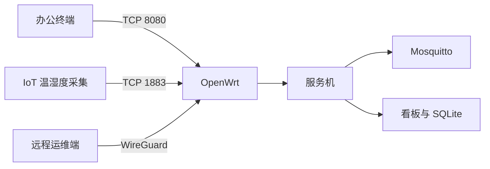

# Warehouse Netops

基于 OpenWrt 的小型仓库网络分区与远程运维系统。

办公终端查看温湿度，IoT 设备上传采样，远程网管通过 WireGuard 维护服务。采集、存储和现场看板运行在仓库内部，外网中断时仍能工作。

## 功能

- 办公、IoT、服务三个独立分区，按业务需要放行端口。
- WireGuard 远程接入，只开放指定服务机的看板和 SSH。
- MQTT 设备认证与主题权限，设备发布和看板订阅使用不同账号。
- 温湿度实时显示、独立历史曲线和 SQLite 持久化。
- 分别显示消息服务连接状态与采样新鲜度，保留最后一次有效读数。
- 自动执行访问矩阵、身份关联、断 WAN 和停止 Broker 的故障验证，并核对恢复结果。
- 四台 VMware 虚拟机组成可重复演示的仓库现场；提供 ESP32 + DHT22 固件及 Wokwi 电路。

## 架构



| 来源 | 看板 8080 | MQTT 1883 | SSH 22 |
| --- | --- | --- | --- |
| 办公区 | 允许 | 拒绝 | 拒绝 |
| IoT 区 | 拒绝 | 允许 | 拒绝 |
| WireGuard 运维端 | 允许 | 拒绝 | 允许 |
| WAN 直接访问 | 拒绝 | 拒绝 | 拒绝 |

办公区与 IoT 区相互隔离。服务区用于可信主机接入与维护。

## 快速启动

本地演示需要 Python 3.11+、Docker 和 Docker Compose。

```sh
git clone https://github.com/Adan-02/warehouse-netops.git
cd warehouse-netops
python tools/lab.py init --demo
python tools/lab.py up
python tools/lab.py demo --count 12
```

打开 [localhost:8080](http://127.0.0.1:8080)。模拟发布器每 5 秒发送一次温湿度，页面明确标注数据来源；20 秒没有新的有效采样时，数据状态变为过期。

```sh
python tools/lab.py status
python tools/lab.py down
```

停止服务会保留数据库卷。初始化时生成的 MQTT 密码存放在本地 `server/.env`，重复初始化保留既有凭据。

## 配置与数据

服务默认只绑定 `127.0.0.1`。接入实验网络时，使用服务主机实际拥有的地址：

```sh
python server/setup.py --bind-ip 192.168.30.10 --demo
```

MQTT 主题为 `warehouse/cabinet-01/telemetry`：

```json
{"device_id":"cabinet-01","seq":1,"temperature_c":24.5,"humidity_pct":48.2}
```

服务端使用接收时间判断数据新鲜度。消息服务断开和数据过期分别显示，便于区分网络、消息服务与采集问题。

## 文档

- [项目设计](PROJECT.md)
- [单电脑虚拟实验](docs/virtual-lab.md)
- [演示手册](docs/demo-runbook.md)
- [服务配置与接口](server/README.md)
- [OpenWrt 配置](router/README.md)
- [ESP32 固件](firmware/README.md)
- [Wokwi 电路](firmware/WOKWI.md)
- [验收与故障实验](docs/acceptance.md)

## 开发

```sh
python -m pip install -r server/requirements.txt
python -m unittest discover -s server/tests -v
python -m unittest discover -s tools/tests -v
```

虚拟网络检查和部署工具位于 `virtualization/`；现场配置、私钥、数据库、VM 磁盘和备份留在本地，不进入版本库。
