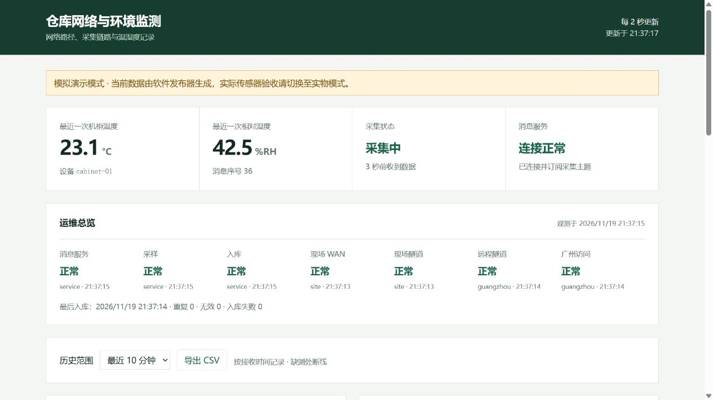
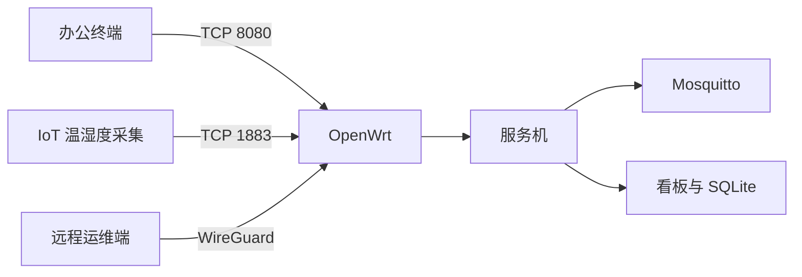

# Warehouse Netops

基于 OpenWrt 的小型仓库网络分区与远程运维系统。

办公终端查看温湿度，IoT 设备上传采样，远程网管通过 WireGuard 维护服务。采集、存储和现场看板运行在仓库内部，外网中断时仍能工作。

[](docs/images/dashboard-full.jpg)

## 功能

- 办公、IoT、服务三个独立分区，按业务需要放行端口。
- WireGuard 远程接入，只开放指定服务机的看板和 SSH。
- MQTT 设备认证与主题权限，设备发布和看板订阅使用不同账号。
- 分层显示现场 WAN、两侧 WireGuard、远程访问、MQTT、采样和入库状态，标明观测来源与时间。
- 温湿度实时显示，支持 10 分钟、24 小时、7 天历史与 CSV 导出；缺测区间断线显示。
- 记录故障和恢复事件，支持带持续时间与回差的温湿度告警。
- 用启动标识和采样序号识别重复消息，兼容旧设备和历史数据。
- 通过广州端发送带签名的 Webhook，持久保存通知游标与重试队列。
- 自动执行访问矩阵、身份关联、断 WAN 和停止 Broker 的故障验证，并核对恢复结果。
- 按 Git 提交构建不可变镜像，校验运行版本，支持应用回滚、SQLite 一致性备份与隔离恢复检查。
- 四台 VMware 虚拟机组成可重复演示的仓库现场；提供 ESP32 + DHT22 固件及 Wokwi 电路。

## 架构



| 来源 | 看板 8080 | MQTT 1883 | SSH 22 |
| --- | --- | --- | --- |
| 办公区 | 允许 | 拒绝 | 拒绝 |
| IoT 区 | 拒绝 | 允许 | 拒绝 |
| WireGuard 运维端 | 允许 | 拒绝 | 允许 |
| WAN 直接访问 | 拒绝 | 拒绝 | 拒绝 |

办公区与 IoT 区相互隔离。服务区用于可信主机接入与维护。

## 快速启动

本地演示需要 Python 3.11+、Docker 和 Docker Compose。

```sh
git clone https://github.com/Adan-02/warehouse-netops.git
cd warehouse-netops
python tools/lab.py init --demo
python tools/lab.py up
python tools/lab.py demo --count 12
```

打开 [localhost:8080](http://127.0.0.1:8080)。模拟发布器每 5 秒发送一次温湿度，页面明确标注数据来源；20 秒没有新的有效采样时，数据状态变为过期。消息服务、采样新鲜度和数据库写入分别显示，外部网络观测超过 35 秒未更新时显示未知。

```sh
python tools/lab.py status
python tools/lab.py down
```

停止服务会保留数据库卷。初始化时生成的 MQTT 密码存放在本地 `server/.env`，重复初始化保留既有凭据。

## 配置与数据

服务默认只绑定 `127.0.0.1`。接入实验网络时，使用服务主机实际拥有的地址：

```sh
python server/setup.py --bind-ip 192.168.30.10 --demo
```

MQTT 主题为 `warehouse/cabinet-01/telemetry`：

```json
{"device_id":"cabinet-01","boot_id":"5a5beefb91244a12a3a938bd29dab834","seq":1,"temperature_c":24.5,"humidity_pct":48.2}
```

`boot_id` 每次设备或发布进程启动时生成，重连保持不变。同一启动会话中的重复消息不重复入库，也不刷新在线时间。服务端使用接收时间判断新鲜度，序号缺口只表示未接收的采样，不直接等同于网络丢包。

告警、历史保留周期使用本地 JSON 配置。模拟配置采用温度 18–28°C、湿度 30–70%RH，连续越限 30 秒触发，持续恢复 30 秒关闭；这些是演示值。原始读数默认保留 90 天，已关闭事件保留 180 天。

## 接口

| 接口 | 用途 |
| --- | --- |
| `/api/status` | 最新读数、采样新鲜度、MQTT 与入库状态 |
| `/api/health` | 带来源、时间和证据的分层健康观测 |
| `/api/events` | 故障、告警与恢复时间线 |
| `/api/history/range`、`/api/history/export.csv` | 时间范围查询与原始记录导出 |
| `/api/version` | 运行版本、Git 提交与源码摘要 |
| `/healthz` | HTTP 进程存活检查 |

`/api/health` 的每个环节分别返回 `healthy`、`unhealthy` 或 `unknown`，过期的网络快照归为未知。整体状态保留异常和未知，不把 HTTP 可达直接视为采集正常。

看板和业务接口保持只读；运维配置、发布和恢复通过本地工具及受控 SSH 路径完成。

## 文档

- [接手说明](docs/HANDOFF.md)
- [项目设计](PROJECT.md)
- [单电脑虚拟实验](docs/virtual-lab.md)
- [演示手册](docs/demo-runbook.md)
- [服务配置与接口](server/README.md)
- [只读观测与 Webhook](ops/README.md)
- [版本发布、回滚与备份](docs/versioning.md)
- [OpenWrt 配置](router/README.md)
- [ESP32 固件](firmware/README.md)
- [Wokwi 电路](firmware/WOKWI.md)
- [验收与故障实验](docs/acceptance.md)
- [v0.5 验证记录](docs/verification-v0.5.md)

## 开发

```sh
python -m pip install -r server/requirements.txt
cd server
python -m unittest discover -s tests -v
cd ..
python -m unittest discover -s tools/tests -v
```

虚拟网络检查和部署工具位于 `virtualization/`；现场配置、私钥、数据库、VM 磁盘和备份留在本地，不进入版本库。
