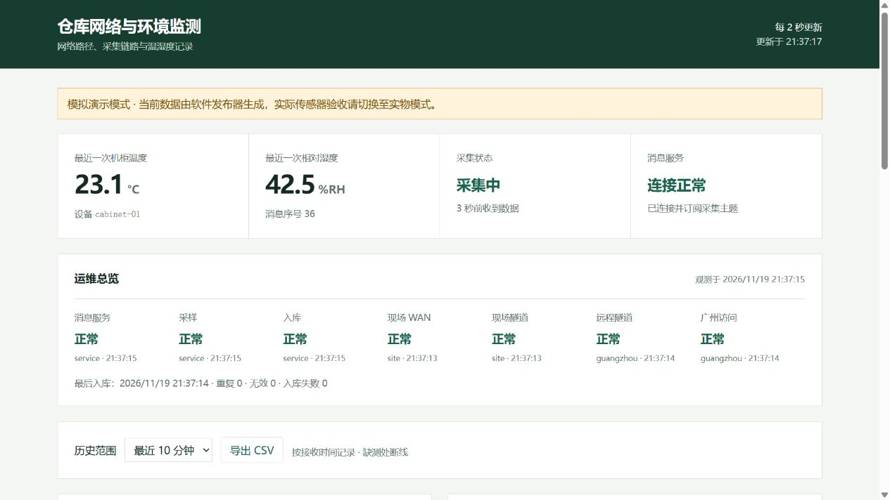
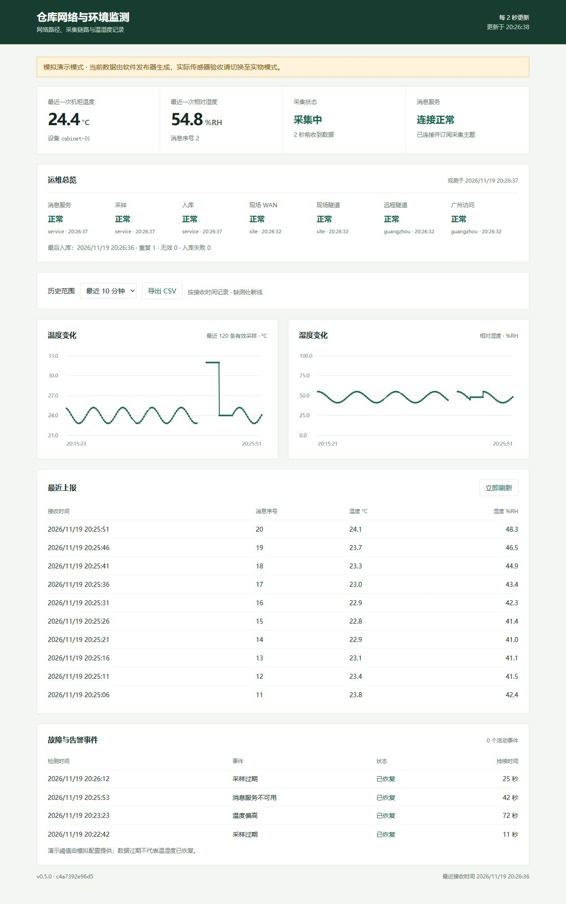

# v0.5 验证记录

日期：2026-11-19。环境为一台 Windows 电脑、四台 VMware 虚拟机与广州独立运维端。温湿度由 IoT VM 的软件发布器提供，访问和故障均经过实际运行的虚拟分区网络。美国服务器及其 v2rayN 转发不参与部署或故障注入。

本文只摘录版本、检查结果和恢复状态。原始 JSON、日志、数据库与配置备份保留本机；这里的文件名用于定位原始证据。最终验收进展见 [PROGRESS.md](../PROGRESS.md)，操作命令见[版本发布与回退](versioning.md)及[演示手册](demo-runbook.md)。

## 版本与构建

| 对象 | 记录 |
| --- | --- |
| 已发布并进行业务验收的版本 | `v0.5.0-c4a7392e96d5` |
| 对应 Git 提交 | `c4a7392e96d5b04514014c2d56d969038a396ae8` |
| 数据库 schema | 3 |
| 最终部署版本 | `v0.5.0-12550d15ec97` |
| 最终部署的 Git 提交 | `12550d15ec978690acaab5b179f0e740ca91853d` |
| 最终部署镜像 ID | `sha256:0c1a92b3ee70fdee97c598e5019ba8a7dfcb57b99df84bf9caa2df54f146e608` |
| 两次构建的业务源码摘要 | `dc2b4d6c6f78d2be1e68da91745ce254ccc711e6a15c4f683a6069312aca4406` |

业务源码摘要覆盖镜像内应用；后续提交还包含镜像外的发布传输修复，因此两次摘要相同并不表示两个 Git 提交相同。各项实测按当时运行版本记录。

最终部署结果为 `published=true`，广州端读取版本核对通过，运行 image ID 与清单一致，`sampling_progressed=true`。

## 离线回归与 CI

`c4a7392e96d5` 的 Windows 离线回归共运行 238 项：224 项通过、14 项跳过，失败 0、错误 0。跳过项由既有环境保护条件跳过，包括要求 Linux 可丢弃容器的检查；本次离线批次没有执行 VM、云端或故障操作。Webhook 测试使用显式允许的本机 HTTP 接收端。汇总见 `evidence/final-offline-tests.local.json`。

同一提交的 GitHub Actions 共 5 个 job 通过：应用、Windows 工具以及三个固件环境。固件构建通过表示源码可以编译，不代表 ESP32、DHT22、无线覆盖或 Wokwi 已实机运行。

之后修复 SSH 大输出接收过程中的竞争问题，发布传输专项 37 项全部通过，其中 2 项为新增回归；真实连接另连续 5 次完整接收 300000 字节输出。该专项与前面的 238 项批次分开记录，不将它们改写为完整 240 项回归已通过。

后续提交 `12550d15ec97` 的 [GitHub Actions 5 个 job 也全部通过](https://github.com/Adan-02/warehouse-netops/actions/runs/44523141424)。

冷启动工具及启动错误诊断修复后，另完整运行 `python -m unittest discover -s virtualization -p 'test_*.py' -v`：198 项中 184 项通过、14 项因环境条件跳过，失败与错误均为 0。该批次覆盖全部虚拟化工具测试，与此前包含其他模块的 238 项批次分开记录。主机工具提交 `f938ef03148c` 的 [GitHub Actions 5 个 job 全部通过](https://github.com/Adan-02/warehouse-netops/actions/runs/44534283365)。

## 新版业务链路

在 `v0.5.0-c4a7392e96d5` 上执行，9 项检查全部通过。证据时间为 `2026-11-19T12:22:22Z`，见 `evidence/v05-business-acceptance.local.json`。

| 检查 | 结果 |
| --- | --- |
| 运行版本、源码摘要与 schema | 与发布制品一致，schema 3 |
| 分层健康 | WAN、现场 WireGuard、广州 WireGuard、广州 HTTP、MQTT、采样、存储均为 `healthy` |
| 24 小时历史 | 1441 个时间桶，分辨率 60 秒 |
| 7 天历史 | 2017 个时间桶，分辨率 300 秒 |
| CSV 导出 | 当次快照导出 2430 行 |
| 过期后的重复消息 | 重发同一启动会话、同一序号的消息，最后有效采样时间不变，保持过期 |
| 持续温度告警 | 连续超温 30 秒触发告警 |
| 温度恢复 | 持续恢复 30 秒后关闭告警 |
| 事件变化游标 | 同时读取到独立的 `raised` 和 `recovered` 变化 |

告警使用项目的模拟阈值，并非企业仓库通用标准。实验结束后正常模拟发布器已恢复，检查确认带 `boot_id` 的新采样继续，`restoration.verified=true`。历史时间桶包含按分辨率对齐的边界桶，数量不直接等同于采样条数。

## 浏览器检查

冷启动后再次从广州路径读取实际看板，页脚版本为 `v0.5.0 · 12550d15ec97`，七项实时状态全部正常，采样序号继续增长。

已实际切换 10 分钟、24 小时和 7 天历史，页面正常显示对应范围。点击 CSV 按钮产生实际下载，文件表头与数据有效。

390×844 窄屏下，页面 `clientWidth` 与 `scrollWidth` 均为 375，未出现横向溢出。

## 应用回滚与数据备份

已实际执行两个方向的应用回滚：`v0.5.0-c4a7392e96d5 → legacy`，以及 `legacy → v0.5.0-c4a7392e96d5`。两次结果均为 `rolled_back=true`，恢复对应运行版本并继续采样。该过程切换应用镜像和配置指针，没有把活动数据库恢复成旧快照。

独立执行 SQLite 在线备份与隔离恢复检查，结果如下，见 `evidence/v05-backup-restore.local.json`：

| 项目 | 结果 |
| --- | --- |
| 备份记录数 | 2385 行 |
| 恢复后的完整性检查 | `ok` |
| 隔离恢复 | `isolated_restore=true` |
| 活动数据库 | `active_database_modified=false` |
| 总体结果 | `passed=true` |

行数对应当次备份时间，后续采样继续增加。数据库恢复检查只操作临时副本；它与应用回滚是两项独立实验。

## 断 WAN 与自动恢复

证据为 `evidence/v05-wan-disconnect.local.json`，记录时间 `2026-11-19T12:20:12Z`。通过 OpenWrt 的本地 COM1 控制执行实际 WAN 断开，故障保持 45.17 秒，14 项检查全部通过。

- 故障前先核对当前访问矩阵、本地采样、WAN 和广州 HTTP/WireGuard 基线。
- 故障期间办公网页仍可访问，本地采样继续推进，广州网页访问失败。
- 脚本恢复 WAN 后，本地采样、WAN、广州 HTTP 和有效握手均通过复核。
- 恢复为必须执行项，记录为 `required=true`、`attempted=true`、`verified=true`。

该实验验证现场采集独立于远程管理路径。旧握手记录不单独作为远程在线证据，恢复包含实际 HTTP 请求。

## 停 Broker 与故障定位

证据为 `evidence/v05-broker-stop.local.json`，记录时间 `2026-11-19T12:24:42Z`。Broker 实际停止 31.22 秒，13 项检查全部通过，`restoration.verified=true`。

故障期间办公与广州网页仍可打开，广州指定密钥 SSH 登录成功，WireGuard 路径正常；MQTT 连接断开，保留最后读数，采样过期。独立读取 `/api/health` 的快照见 `evidence/v05-broker-during-health.local.json`：

| 状态 | 环节 |
| --- | --- |
| `unhealthy` | MQTT、采样 |
| `healthy` | 存储、WAN、现场 WireGuard、广州 WireGuard、广州 HTTP |

该快照同时包含活动的 `broker_subscription_unavailable` 和 `telemetry_stale` 事件，待持久化事件数及事件缓存丢失数均为 0。浏览器也实际显示消息连接中断和采集离线；恢复 Broker 后采样回到新鲜状态，事件关闭。

下面是恢复后的实际页面，截图采于 `c4a7392e96d5` 运行阶段，页脚保留该版本：

## 冷启动过程与控制工具修复

首轮流程未通过有序关闭检查，失败记录保存在 `evidence/v05-cold-boot-first-attempt.local.json`。路由器后台关机命令与串口退出码探针组合后产生 shell 语法错误，现已修复，并用假 `poweroff` 验证语法、异步调度及 marker 顺序。早期开机串口丢字符还曾让 Office shell 停在未闭合引号的续行中；Console 现先发送 Ctrl-C 与回车，再执行独立命令。

真实 Office 控制台已复现续行状态并验证恢复，`false` 的非零退出码也正确返回，见 `evidence/v05-console-recovery.local.json`。Console 专项在 Windows 为 3 项通过、1 项 PTY 跳过，在 Linux 容器真实 PTY 中 4 项全部通过。关机控制、参数校验和启动错误诊断测试均已纳入上面的 198 项完整工具回归。

第二轮四台 VM 均正常关机，有序关闭耗时 105.31 秒；随后启动 Router 时，已关机 VM 仍被管理员 VMware 标签页占用，后台返回“文件正在使用中”。该次记录保存在 `evidence/v05-cold-boot-second-attempt.local.json`。用户关闭对应标签页后配置占用释放，未删除锁、修改权限或结束 VMware 进程。下述恢复检查沿用这次关机前的版本、启动 ID 和数据基线。

本机单 vCPU/WHP 环境中 service 启动曾约需 6 分钟，关键链里的 cloud-init、Docker、应用栈分别观测到约 96、40、81 秒。控制器的业务就绪预算现为 600 秒，非正数超时和 `stop --wait` 在任何 VM 操作前拒绝。这些耗时属于当前环境的观测值；上述控制工具失败不并入 WAN 或 Broker 业务故障的通过结论。

## 冷启动最终验收

`evidence/v05-cold-boot.local.json` 的 6 项检查全部通过，`passed=true`。四台 VM 使用原有配置重新启动，未手动启动任何 guest 服务；人工干预仅为关闭已关机 Router 的管理员 VMware 标签页。

| 检查 | 结果 |
| --- | --- |
| 有序关闭 | 四台 VM 均正常关机，105.31 秒 |
| 恢复后的业务就绪 | 在 600 秒观察预算内变为 `healthy` |
| 实际重启 | 四台 VM 的内核启动 ID 全部改变 |
| 历史保留 | 2557 行增至 2571 行，首条记录未变，SQLite `quick_check=ok` |
| 运行版本 | 仍为 `v0.5.0-12550d15ec97`，schema 3，源码摘要一致 |
| 实时分层健康 | MQTT、采样、存储、WAN、两侧 WireGuard、广州 HTTP 均为 `healthy` |

恢复控制器从北京时间 21:29:40 开始记录业务观测，于 21:34:59 观测到健康，观察窗口约 319.5 秒。三台 Debian 更早已开始启动，因此该窗口不等同于四台 VM 从断电到就绪的总耗时，也不包含等待人工释放标签占用的时间。

## 受限观测身份与通知边界

广州回送身份的三种限制已实测：任意命令、PTY 请求和转发通道均被限制，3 项检查通过，见 `evidence/observer-reporter-restrictions.local.json`。

Webhook 的公网外发保持关闭；签名、幂等标识、重试与游标事务由临时数据库及本机接收端验证。真实外部 Webhook 投递、实体无线、ESP32/DHT22、Wokwi 实际运行及公网来源的访问测试不在上述结论范围内。
